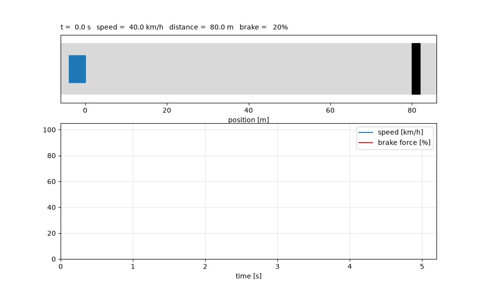

# NAI_Carbreak_Fuzzy

**1. HOW TO USE** <br />

Instructions:

```
(.venv) telashar@Holo-PC ~/P/NAI_CarBreak_Fuzzy (main)> python main.py -h
usage: Car breaking simulation [-h] name [0,301] [0,11]

Uses fuzzy logic to simulate car breaking

positional arguments:
  name        name of the saved file
  [0,150]     define starting speed [km/h]
  [0,10]      define road conditions: 0=dry, 5=wet, 10=icy

options:
  -h, --help  show this help message and exit
```

Example:


```
telashar@Holo-PC ~> python ./main.py braking.gif 40 10
```


Now example with a crash:
```
(.venv) telashar@Holo-PC ~/P/NAI_CarBreak_Fuzzy (main)> python ./main.py crashing?.gif 120 0
```


Other scenario (without commands):
