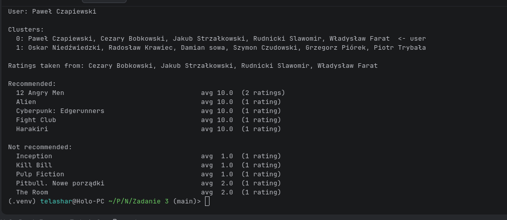

**1. HOW TO USE** <br />

Instructions:

```
(.venv) telashar@Holo-PC ~/P/N/Zadanie 3 (main)> python main.py -h
usage: main.py [-h] [-m MODE] [-k CLUSTERS] [-n COUNT]

Create movie recommendation system

options:
  -h, --help            show this help message and exit
  -m, --mode MODE
  -k, --clusters CLUSTERS
                        number of user clusters for k-means
  -n, --count COUNT     how many titles to recommend / advise against
```

Example:


